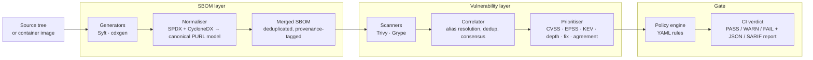

# Architecture

For a walk through one scan, see [`HOW_IT_WORKS.md`](HOW_IT_WORKS.md).

## Canonical model

- **Component**: identity key `type/namespace/name@version`, from the PURL after normalisation. Carries `source_name` and `source_version` (Debian and RPM), `depth` (the shortest distance from the target in a generator's dependency graph, 1 for a direct dependency; only graphs that start at the target count) and `found_by` (the set of generators that reported it).
- **Finding**: keyed on (`component`, canonical CVE). Carries one claim per scanner (its own IDs, severity, CVSS, fix state and versions, and Grype's own EPSS and KEV, for cross-checking only), the generators that list the component, `consensus` = generators × scanners (D10), the count of single pipelines that reported it, its enrichment (EPSS and KEV from dated snapshots, the highest CVSS, fix availability, and the component's depth), and its priority: a 0–100 score, band and rank, with every factor's points. Findings on entries that are not installed software are kept and marked (D9).
- **Verdict**: PASS, WARN or FAIL, the rules that fired, and the findings that triggered them.

## Design rules

Each rule exists because a tool behaved in a way that, left alone, gives a wrong or misleading result.

| # | Rule | Why |
|---|---|---|
| D1 | Resolve vulnerability aliases to a canonical CVE before any merge or count. IDs linked as OSV `aliases` are one vulnerability, counted once; an advisory's `upstream` CVEs are each covered | Two scanners name the same vulnerability differently (CVE against GHSA), so raw IDs make them look like they disagree on almost everything |
| D2 | Carry Debian, RPM and Alpine **source-package** identity through the model, keyed on the binary package, and write it into every field a scanner reads | Distribution advisories are per source package, and each tool records the source package somewhere different. A scanner that cannot see it loses most operating-system findings |
| D3 | Every emitted SBOM gets an `operating-system` component and **every identifier its inputs carried**: PURL with `distro` and `arch`, source package, primary *and alternate* CPEs, and a name that does not fold in the PURL namespace. Every run with a direct scan checks the hand-off: each SBOM pipeline against the same scanner's direct scan, per (component, CVE) pair | Without an operating-system component Trivy reports nothing for operating-system packages. Each dropped identifier costs findings |
| D4 | Canonicalise versions per ecosystem before deduplication, for identity only: PEP 440 for PyPI, epoch 0 for Debian and RPM, and deliberately nothing for Maven, whose versions are coordinates. Output keeps a spelling some tool reported | Django appears as both `3.2` and `3.2.0`, which splits every count and double-counts every advisory |
| D5 | Prefer lockfiles or resolved trees, and flag unlocked manifests. Survey the target before any generator runs, since generators run build tools that write into it | Without a lockfile the dependency tree is resolved on the day of the scan, and only some generators resolve it, so findings can differ between scans |
| D6 | Pin tool versions and vulnerability-database snapshots, and record both in every report | Tool behaviour drifts across versions, and databases change daily |
| D7 | SPDX output also carries an `OPERATING-SYSTEM` package; the hand-off check covers every output format | The same tool found operating-system vulnerabilities through a CycloneDX SBOM and none through an SPDX one of the same image |
| D8 | Record interpreter and build-tool versions with every run, and use one fixed build environment | cdxgen lists a different set of Python components depending on whether a `python` command exists on the `PATH` |
| D9 | Only installed software is a component. Leave out entries of non-software kinds (CycloneDX `file`, `data`; SPDX `FILE`), and suppress OS source packages listed as if installed when another generator's stated source identity shows them to be one; never infer either from identity confidence. Keep and mark findings against what was left out | cdxgen lists files and source packages with package URLs. Counting them inflates the inventory and attributes (for example) kernel vulnerabilities to unrelated applications |
| D10 | Count evidence, not pipelines. A correlated finding's consensus is the generators that list the component as installed software times the scanners that report the vulnerability on it through any SBOM pipeline. Keep each scanner's own claim. A direct scan is a reference, never evidence | Counting pipelines measures their hand-off failures as well as the evidence, and makes well-supported findings look weak |
| D11 | A jar that generators list under different Maven groups is one component: same artifact ID and version, found in a jar of the same file name, and no generator listing two of the keys. Keep the group with the strongest evidence (a SHA-1 lookup in Maven Central, then a stated group, then none); when the strongest evidence is shared, keep the keys apart and say so | Syft writes the artifact ID as the group when it finds none, and otherwise guesses, so one jar can appear twice |

## Code layout

| Module | Layer | Does |
|---|---|---|
| `cli.py` | Gate | `chainguard scan` (with `--gate`), `reprocess`, `gate`, `report`, `tools`, `db update` (scanner databases and the EPSS and KEV snapshots), `sbom normalize`, `sbom repair`, `sbom merge` |
| `pipeline.py` | Orchestration | One run: the target's dependency manifests surveyed, generators → scanners (and a direct scan, by default for images), then the analysis (normalise → resolve aliases → correlate → enrich → prioritise → check the hand-off → measure the configurations) → write the run directory. `reprocess` repeats only the analysis from `raw/`, and with `--aliases recorded` replays the alias resolution the run recorded |
| `action.yml` (repository root) | CI | The GitHub Action: builds the fixed environment, downloads the databases and snapshots, scans, gates, writes the job summary, uploads the SARIF log; the job fails when the gate does |
| `toolchain.py`, `toolchain.env` | Reproducibility | Pins, installed versions, database snapshots, build environment (D6, D8) |
| `target.py`, `runner.py` | Orchestration | Target resolution (directory, image archive, `image:<ref>`); recorded tool invocations |
| `generators.py` | SBOM layer | Syft and cdxgen adapters |
| `sbom.py`, `purl.py` | SBOM layer | CycloneDX and SPDX 2.x JSON → canonical PURL keys; entries that are not software left out (D9); each component's depth in the generator's dependency graph |
| `versions.py` | SBOM layer | D4: each ecosystem's canonical version, used in identity keys only |
| `scanners.py` | Vulnerability layer | Trivy and Grype adapters → one `Finding` shape (including Grype's EPSS and KEV data) |
| `ospackage.py` | SBOM layer | D2: the source package of an OS component, read from every carrier the four tools use and written back to all of them |
| `repair.py` | SBOM layer | Rewrites an SBOM so a scanner can read what the generator recorded; invents nothing |
| `merge.py` | SBOM layer | D3, D7: writes the canonical inventory as one CycloneDX and one SPDX document, with the OS component and every identifier the inputs carried |
| `lockfiles.py` | SBOM layer | D5: every dependency manifest in a source target (npm, pip, Poetry, Pipenv, setuptools, Maven, Gradle) as locked, pinned, unlocked or not checked, surveyed before any generator runs; reads files, runs nothing |
| `handoff.py` | Vulnerability layer | D3, D7: every SBOM pipeline against the same scanner's direct scan, per (component, canonical ID) pair; each lost pair classed as misattributed, hand-off, other version or not listed; never "lossless" without a reference |
| `aliases.py` | Vulnerability layer | D1: OSV.dev aliases (one class, counted once) and upstream (each CVE covered), then scanner metadata; on-disk cache, offline mode, per-reason counts of what stays unresolved; a run's recorded resolution can be applied again |
| `enrich.py` | Vulnerability layer | Dated FIRST EPSS and CISA KEV snapshots, stored under their own date or catalogue version and never overwritten; each correlated pair's EPSS, KEV, highest CVSS, fix availability and depth; Grype's own values compared, never used |
| `priority.py`, `priority.yaml` | Vulnerability layer | The priority score: 100 × the weighted mean of EPSS, KEV, CVSS, fix, depth and consensus, with weights and bands in YAML; every finding's per-factor explanation; ablations and single-factor baselines |
| `correlate.py` | Vulnerability layer | Merged inventory with provenance; source packages listed as installed suppressed (D9); one jar under two Maven groups merged on evidence (D11); (component, canonical ID) correlation with one claim per scanner and consensus as evidence (D10) |
| `metrics.py` | Reporting | The six configurations (each single pipeline, the naive union, the fused pipeline) as reported, with aliases resolved and normalised: coverage, and agreement between generators, between scanners on each SBOM, and between the naive union and the fused pipeline. Combined across runs; runs nothing |
| `policy.py`, `policy.yaml` | Gate | A run judged PASS, WARN or FAIL: integrity checks that fail closed (failed tool, empty SBOM, no scan, no scores, missing snapshot), YAML rules on each finding, time-boxed exceptions; `verdict.json` with every reason |
| `reports.py` | Gate | A judged run as SARIF 2.1.0 for code scanning (each result at the line declaring its package, security-severity from CVSS, within GitHub's limits), a JSON report and a Markdown job summary |
| `report.py` | Gate | The run summary: coverage, per-pipeline findings, enrichment, priority, the configurations as reported and normalised, the hand-off check |

## Tool pins

The single source of truth is [`src/chainguard/toolchain.env`](../src/chainguard/toolchain.env), currently Syft 1.52.0 · cdxgen 12.8.5 · Trivy 0.74.0 · Grype 0.119.0. The core language is Python 3.11+, CI is GitHub Actions, and the container runtime is Docker or Podman. The fixed build environment is the repository's [`Dockerfile`](../Dockerfile) (D8): Python 3.12, Node 22, JDK 17 and Maven, with base images pinned by digest. Bump one tool at a time, then run the tests and a scan of the [examples](../examples/README.md) before and after.
